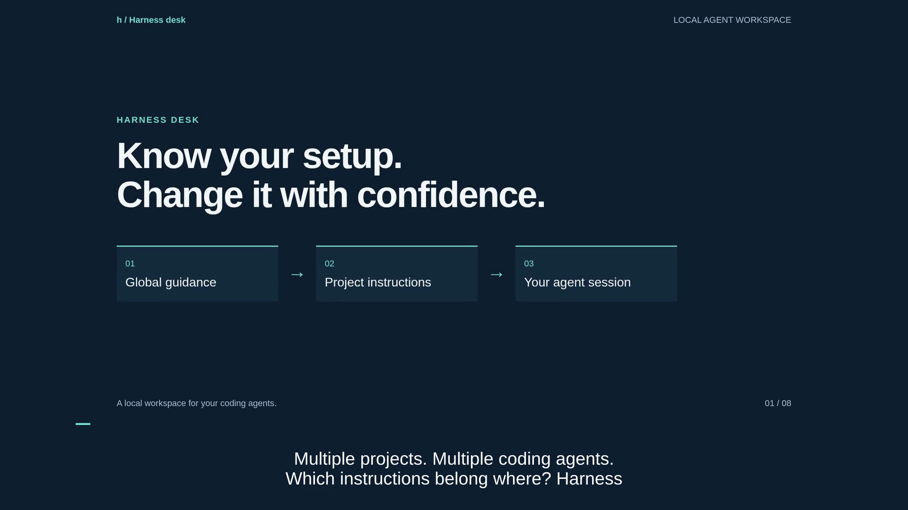

# Harness Desk

Understand what your coding agent loads, where it comes from, and what needs attention. Improve one thing, then compare a fresh session to check the result.

**Early preview · Node.js 22+ · No runtime dependencies**

[Quick start](#quick-start) · [User guide](https://github.com/maruthiprithivi/harness-desk/blob/main/docs/user-guide.md) · [Agent support](#agent-support) · [Documentation](#documentation) · [Contribute](CONTRIBUTING.md)

[](https://github.com/maruthiprithivi/harness-desk/raw/refs/heads/main/docs/assets/explainer/harness-desk.mp4)

[Watch or download the 1:45 walkthrough](https://github.com/maruthiprithivi/harness-desk/raw/refs/heads/main/docs/assets/explainer/harness-desk.mp4). Narration and captions; all examples use synthetic data.

## Quick start

The npm release is being prepared. Run the source today:

```sh
git clone https://github.com/maruthiprithivi/harness-desk.git
cd harness-desk
npm start
```

Open **http://127.0.0.1:4319**. The launcher keeps the app running in the background and prints its PID and log location. See [runtime controls](https://github.com/maruthiprithivi/harness-desk/blob/main/docs/runtime.md) for stopping it, changing ports and troubleshooting.

## Your first improvement

1. **Understand:** choose a project and agent; explore global and project instructions, skills and MCP configuration.
2. **Improve:** choose one finding; edit its source with syntax highlighting, review the diff and save with a backup.
3. **Verify:** run the same representative task before and after. Supported adapters capture their own readings automatically.

The canvas groups related sources and shows their origins. Repeated-work analysis can propose concise skills and reusable scripts. Scoped chats let you ask a coding agent for help after reviewing what will be sent.

Follow the [illustrated user guide](https://github.com/maruthiprithivi/harness-desk/blob/main/docs/user-guide.md) for a complete walkthrough.

## Agent support

| Agent | Automatic measurement | Validation |
| --- | --- | --- |
| Codex, OpenCode, Oh My Pi, Kimi | First-request input | Live macOS checks |
| Claude Code | First-response input, including cache | Fixtures pass; managed live check quota-blocked |
| Pi | First-request input | Fixtures only |
| Kiro | Context percentage after the response | Live macOS check; no startup-token comparison |
| Orca | Discovery and manual handoff | No automatic measurement |

Instruction-loading predictions cover Claude Code and Codex. **A discovered file is not proof of loading.** Input readings include your prompt; no adapter verifies a complete system/tools/skills breakdown. See [measurement limits](https://github.com/maruthiprithivi/harness-desk/blob/main/docs/context-measurement-capabilities.md).

macOS has local validation. Windows remains experimental while [native acceptance work](https://github.com/maruthiprithivi/harness-desk/issues/6) is completed.

## Privacy and control

The dashboard listens on loopback. Inventories, chats, reports and backups stay local. Agent requests are explicit and may send reviewed context to the selected provider. Verification runs can consume tokens and start configured hooks or tools.

Configuration saves require review and create a backup. Archiving generated data preserves it; it does not reclaim disk space. Read the [privacy and recovery guide](https://github.com/maruthiprithivi/harness-desk/blob/main/docs/privacy.md) before changing your setup.

## Documentation

| Need | Read |
| --- | --- |
| Get your first useful result | [User guide](https://github.com/maruthiprithivi/harness-desk/blob/main/docs/user-guide.md) |
| Understand and edit configuration | [Configuration guide](https://github.com/maruthiprithivi/harness-desk/blob/main/docs/configuration.md) |
| Turn repeated work into scripts and skills | [Reusable workflows](https://github.com/maruthiprithivi/harness-desk/blob/main/docs/workflows.md) |
| Start, stop or troubleshoot | [Runtime controls](https://github.com/maruthiprithivi/harness-desk/blob/main/docs/runtime.md) |
| Understand observed versus estimated context | [Measurement capabilities](https://github.com/maruthiprithivi/harness-desk/blob/main/docs/context-measurement-capabilities.md) |
| Protect data and restore changes | [Privacy and recovery](https://github.com/maruthiprithivi/harness-desk/blob/main/docs/privacy.md) |
| Build or propose a change | [Contributing](CONTRIBUTING.md) · [Release checklist](https://github.com/maruthiprithivi/harness-desk/blob/main/docs/releasing.md) |

## Development

```sh
npm run hooks:install
npm run check:local
```

Tests use synthetic data and never require signed-in agents. Hooks preserve existing user hooks and block unsafe publication. Run `node server.mjs` for a foreground development server.

[Report a bug](https://github.com/maruthiprithivi/harness-desk/issues) with a synthetic reproduction. For vulnerabilities, follow [SECURITY.md](SECURITY.md).

## License

Project licensing is pending maintainer selection. Package publication remains disabled until it is approved.
