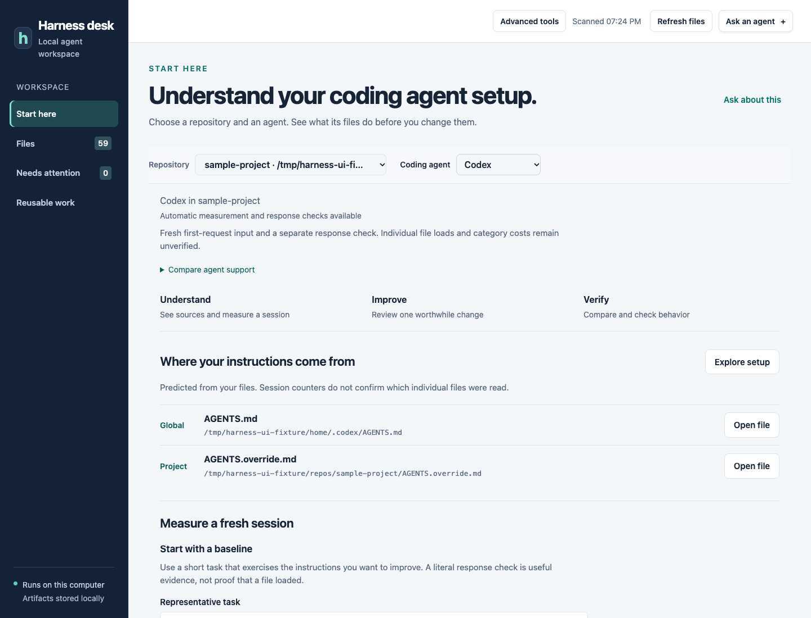
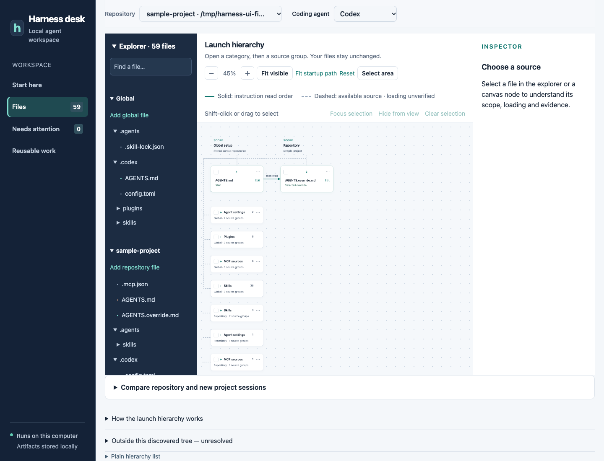
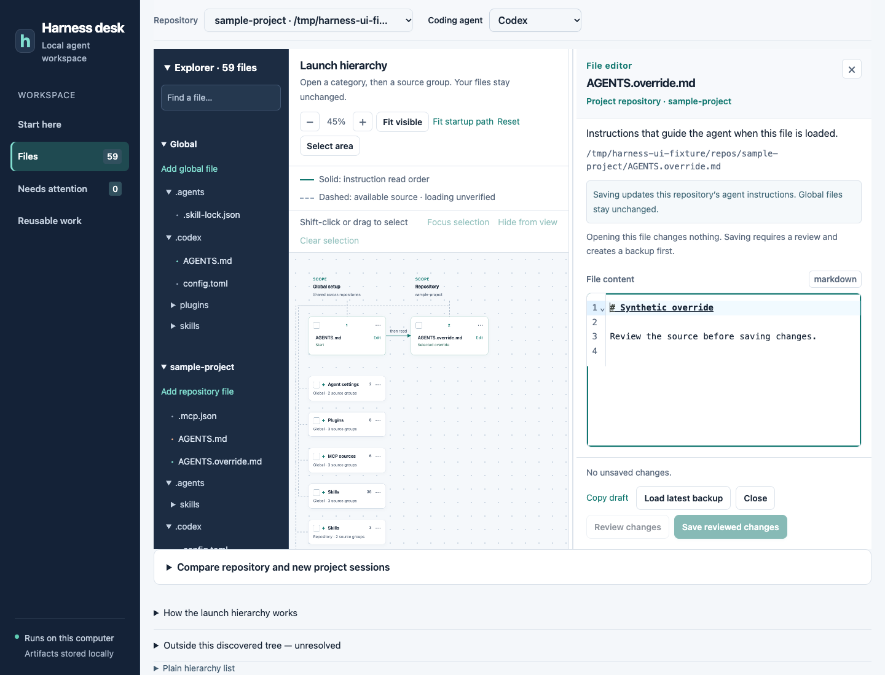
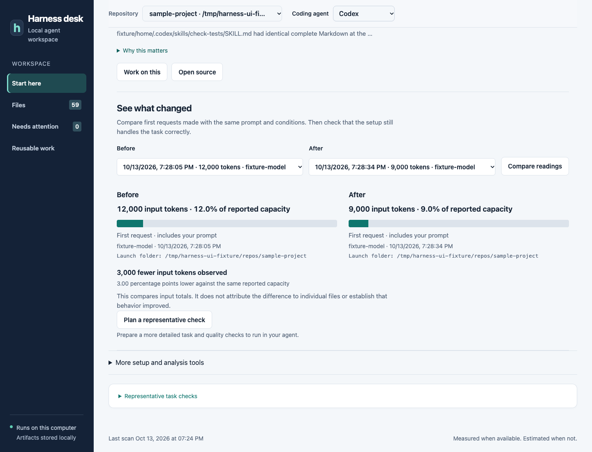

# Your first useful session with Harness Desk

Harness Desk helps you understand the setup around a coding agent, make one reviewed improvement, and compare a fresh session afterward. Start with a project you already work on.

Prefer a walkthrough? [Watch or download the narrated explainer](https://github.com/maruthiprithivi/harness-desk/raw/refs/heads/main/docs/assets/explainer/harness-desk.mp4). Its captions sit below the visuals.

**GitHub beta.** Install the reviewed archive from GitHub Releases or run from source. Windows validation is still in progress. All screenshots below use an isolated synthetic project. The 12,000 → 9,000 comparison is simulated, not a measured saving from a real optimization.

## 1. Open your local workspace

You need Node.js 22 or newer. Follow [Quick start](../README.md#quick-start) to install the GitHub archive, then run:

```sh
harness-desk start
```

Open [the local dashboard](http://127.0.0.1:4319). On macOS, `start.command` is another launcher. Windows has `start.cmd`, but native Windows behavior has not yet been fully validated. See the [Windows work](https://github.com/maruthiprithivi/harness-desk/issues/6).

The launcher prints a process ID and leaves the service running in the background. Run it again after restarting your computer. If the page refuses to connect, check readiness and the printed log location. Installed-package data defaults to `~/.harness-desk`; source-checkout data defaults to `data/` in the checkout. For a source checkout, use `npm start`. See [runtime controls](runtime.md) for ports, stopping and data-directory locks.

In **Start here**, choose **Add your first project** to add a repository folder. **Discover global setup** lets you explore shared files first. Additional setup controls remain under **More setup and analysis tools**. Sign in through the agent's own CLI if needed; do not paste credentials into the dashboard. Use **Refresh files** after making changes outside the app.

## 2. Choose a project and agent

Use the adjacent **Repository** and **Coding agent** selectors. This pair defines what you are investigating. Begin with your existing project and the agent you actually use there.



Read **Where your instructions come from**:

- **Global** belongs to the agent's shared setup and may affect many projects.
- **Project** belongs to the selected repository.
- **Folder guidance** can apply when the agent starts in, or works within, a particular directory.

Choose **Global setup** to inspect shared configuration. For a fresh-session measurement in that mode, supply the actual launch folder. A new folder outside existing projects differs from a new folder inside an existing repository, which can inherit ancestor instructions.

The source list is a prediction from files and supported loading rules. It is not proof that an actual session read every listed file.

## 3. Follow the configuration tree

Open **Files**, then **Canvas & explorer**. Keep the project and agent selectors in view. The explorer on the left finds a source; the canvas shows its relationship to other sources; the right panel explains or edits the selected file.



| What you see | How to use it |
| --- | --- |
| Solid connection | Follow predicted instruction read order. |
| Dashed connection | Inspect available configuration; it does not establish runtime loading. |
| Skills, MCP sources or Plugins | Expand the category, then a source family, then an individual item. |
| Fit visible / Fit startup path | Reframe the canvas instead of hunting for an off-screen node. |
| Select area / Shift-drag | Select several nodes; focus them or temporarily hide other branches. |
| Hide from view | Changes the display only. It does not disable or delete anything. |
| Compare repository and new project sessions | Compare the predicted instruction sources for those starting points. |

Use **Review skills & tools** to search, filter and investigate components. **Inspect MCP servers** reads named server definitions. A configuration-file count is not a count of tools loaded into a session. Missing usage records do not prove that a component is unused; authentication or activity may remain unknown.

## 4. Save a baseline before editing

Return to **Start here → Measure a fresh session**.

1. Write a short **Representative task** that exercises the instructions you care about. For example: “Explain the testing approach required for this project. Do not change files.”
2. Optionally enter literal text you expect in the response. This checks a string, not general correctness.
3. Choose a model if you need a specific one; otherwise the agent's default is used.
4. Read the launch notice, allow the run, and select **Run baseline check**.

The app starts a fresh supported agent session and captures its own reading. You do not need to find log files. Real runs use your account tokens. Configured hooks, extensions and MCP servers may start; read-only shell restrictions do not prevent every startup side effect.

If a run cannot provide a reading, follow its explanation. **What was actually measured** shows the input total even when capacity is unavailable; no percentage is guessed. **Compare agent support** distinguishes real macOS session checks from synthetic tests. Claude and Codex also offer **Read an existing local session instead** as a secondary path. If you switch projects during a run, use **View running check** to return to it, or **Cancel running check** before starting another.

## 5. Improve one thing

Choose one suggestion under **Choose one thing to improve**. Read **Why this matters** before acting.

- **Open source** opens the file so you can edit it yourself.
- **Work on this** prepares a scoped request for an agent. Review the context and your notes, choose the answering agent, then explicitly send it. Opening a draft sends nothing.



From a canvas card, select **Edit**. Drag the editor divider to make more room. Confirm the global or project scope, make your edit, then select **Review changes** and **Save reviewed changes**. Saving creates a local backup. **Load latest backup** puts backup content in the editor for review; it is not an instant unreviewed overwrite. Avoid editing the same file in two applications at once.

Useful small changes include removing a genuine contradiction or moving a detailed, occasionally needed procedure into an explicitly invoked skill with a reusable script. Keep essential constraints available when they are needed. In Claude, an `@path` import in `CLAUDE.md` is eager loading; it is not a lazy pointer.

Agent replies and generated workflows are drafts. Review their contents and test them before adoption. The current application does not automatically rewrite your whole setup.

## 6. Verify the change

Use **Run again after a change** with the same task, model and launch folder. Review the new response as well as the input reading. The automatic run shows its before-and-after result; **See what changed** also lets you choose two saved readings and select **Compare readings**.



**This image is a fixture demonstration. No real optimization produced these numbers.**

| Evidence | What it tells you |
| --- | --- |
| First-request input tokens | The reported input for the first request, including your prompt. |
| Percentage of reported capacity | A share of the capacity reported for that session, when available. |
| File-size estimate | An approximate text size, not an observed runtime contribution. |
| Response text check | Whether the requested literal text appeared. |
| Representative task result | Evidence you must assess for useful behavior; fewer tokens alone are insufficient. |

The comparison does not attribute a difference to one file or prove causation. A lower input count with a worse response is not a successful improvement. Use **Plan a representative check** for a more detailed, user-run task and quality plan. Restore the reviewed backup if the change is unhelpful.

## Support at a glance

Validation status as of 13 October 2026. Check the app and [capability notes](context-measurement-capabilities.md) for the current details.

| Agent | Automatic capture | Validation limit |
| --- | --- | --- |
| Codex | First-request input; optional response text check | Real macOS check completed. |
| OpenCode | First-request input; optional response text check | Real macOS check completed; instruction order is unverified. |
| Oh My Pi | First-request input; optional response text check | Real macOS check completed; instruction order is unverified. |
| Kimi Code | First-request input; optional response text check | Real macOS check completed; instruction order is unverified. |
| Claude Code | Adapter for input capture and response text checks | Synthetic tests pass; fresh managed live run was quota-blocked. |
| Pi | Adapter for input capture and response text checks | Synthetic validation only; no live local installation tested. |
| Kiro | Reported context percentage after the response | Real macOS check completed; not a startup-token savings measurement. |
| Orca | Discovery and manual handoff | No automatic measurement adapter. |

No adapter currently supplies a verified, complete split of every system prompt, tool, MCP, skill and instruction file. Unknown values stay unknown.

## After your first improvement

Use **Needs attention** to review new findings and **Reusable work** to investigate repeated tasks. Review a proposed skill or script, choose project or global placement, and test it before adoption. Keep observations about recurring mistakes and unsupported behavior in the gap ledger. Optional interval scans run while the sidecar is open; scans do not automatically send model requests.

Generated reports, conversations and backups remain local under `data/`. Review the context preview before sending anything to an agent provider. Retention archives generated records; archiving preserves bytes and does not reclaim disk space. Source configuration files are outside retention cleanup.

## Something does not look right?

| Problem | Next step |
| --- | --- |
| Wrong sources or missing files | Check project, agent and launch folder; refresh discovery. Alternate homes, exclusions and managed sources may be unresolved. |
| Context bar has no percentage | Check whether the agent reported capacity. Do not substitute a guessed context window. |
| Baseline failed | Check the CLI installation, sign-in, quota and adapter message. Never paste an auth file into a report. |
| Readings cannot be compared | Use the same task and conditions in two fresh supported sessions. |
| Editor refuses to save | Read the validation message. Another edit, protected content or invalid JSON can block saving. |
| Unsure what an item does | Open its source and prepare a scoped explanation request. |

Report a reproducible issue with synthetic examples and agent/version details. Do not attach real transcripts, credentials or private configuration. See [CONTRIBUTING.md](../CONTRIBUTING.md).

The [Remotion explainer source](../media/explainer/README.md) uses the same synthetic screenshots and includes a reproducible rendering recipe.
